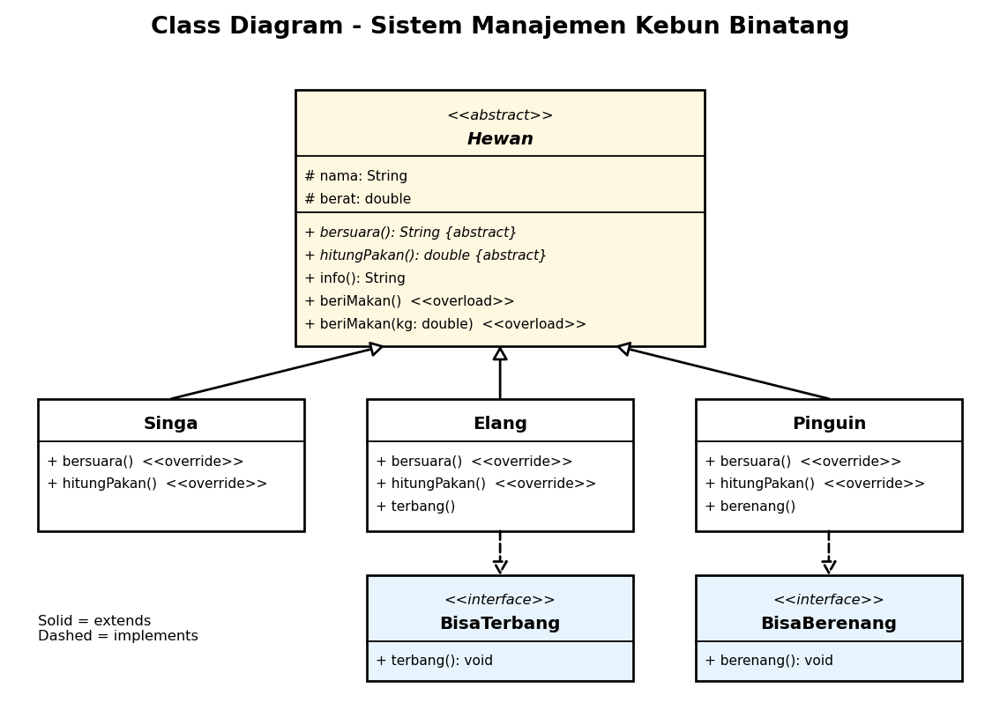

# Sistem Manajemen Kebun Binatang (Tugas PBO)

**Subject forum:** `3D_F1D02510006_F1D02510099`  |  **Anggota:** Dian Irawati (F1D02510006), Yoja Asri Pravida (F1D02510099)

## Kasus
Kebun binatang punya beberapa hewan. Semua hewan punya nama, berat, suara, dan kebutuhan pakan
(dihitung berbeda-beda). Sebagian hewan punya kemampuan khusus (terbang atau berenang).

## Class Diagram


## Penjelasan Konsep
| Konsep | Di kode |
|---|---|
| **Abstract class** | `Hewan` tidak bisa di-`new`. Berisi abstract method `bersuara()` dan `hitungPakan()` |
| **Inheritance** | `Singa`, `Elang`, `Pinguin` `extends Hewan`, memakai `nama`, `berat`, `info()` dari induk |
| **Interface** | `BisaTerbang` (Elang) dan `BisaBerenang` (Pinguin). Pinguin tidak bisa terbang, jadi `terbang()` tidak ditaruh di `Hewan` |
| **Polymorphism** | `List<Hewan>` berisi Singa, Elang, Pinguin; `h.bersuara()` hasilnya beda per objek |
| **Overriding** | `bersuara()` dan `hitungPakan()` ditulis ulang di tiap subclass dengan `@Override` |
| **Overloading** | `beriMakan()` dan `beriMakan(double kg)` di `Hewan` |

**Abstract class vs interface:** abstract class untuk hubungan *is-a* dan boleh punya atribut (Singa adalah Hewan);
interface untuk kemampuan *can-do* dan satu class boleh implements banyak (Elang bisa terbang).

## Diskusi
1. Kenapa `Hewan` dibuat abstract class, bukan interface? Karena semua hewan berbagi atribut (`nama`, `berat`) dan method biasa (`info()`, `beriMakan()`), sedangkan interface tidak boleh menyimpan atribut instance.
2. Kenapa terbang dan berenang dibuat interface? Tidak semua hewan memilikinya. Kalau `terbang()` ada di `Hewan`, Singa dan Pinguin ikut dipaksa terbang.
3. Kalau ditambah `Bebek` (bisa terbang dan berenang), cukup `extends Hewan implements BisaTerbang, BisaBerenang`. Kode `Main` tidak perlu diubah, cukup tambahkan objeknya ke list.
4. Bedanya overriding dan overloading di kode kita: `bersuara()` di-override tiap subclass (dipilih saat runtime), sedangkan `beriMakan()` di-overload dengan parameter berbeda (dipilih saat kompilasi).

## Menjalankan
```
javac -d out src/*.java
java -cp out Main
```

## Contoh Output
```
=== Polymorphism ===
Singa Simba (190.0 kg)
  Suara: Roaarr! | Pakan: 9.5 kg
Elang Rajawali (4.0 kg)
  Suara: Kiiik! | Pakan: 0.4 kg
Pinguin Pingu (30.0 kg)
  Suara: Honk! | Pakan: 4.5 kg

=== Interface ===
Rajawali terbang tinggi
Pingu berenang cepat

=== Overloading ===
Simba diberi porsi standar 9.5 kg
Simba diberi 7.5 kg
```
